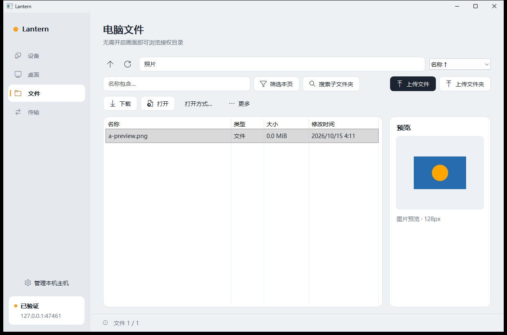
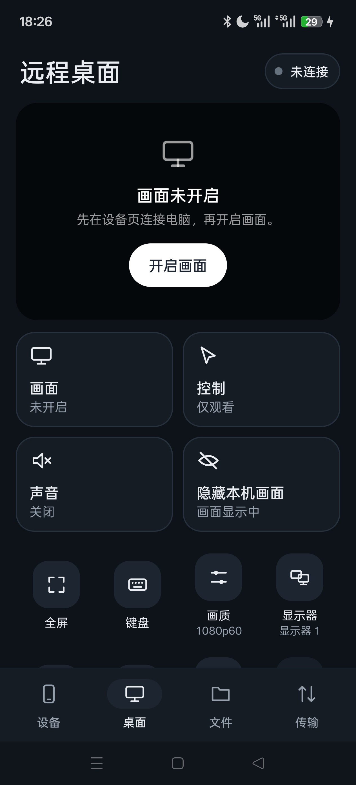
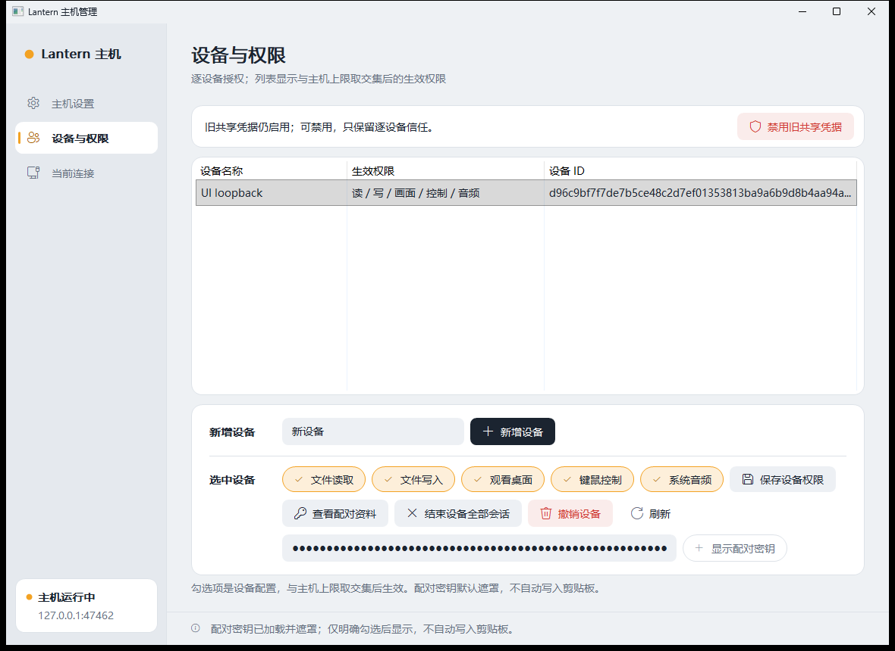
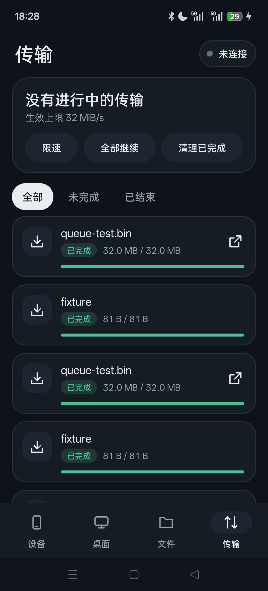

<p align="center">
  
</p>

<h1 align="center">Lantern</h1>

<p align="center">
  在局域网里用手机访问你的 Windows 电脑：远程桌面、浏览文件、双向传输。<br>
  <sub>Remote desktop, file access and transfers between Windows and Android over your LAN.</sub>
</p>

<p align="center">
  <a href="https://github.com/sakura2107/lantern/releases/latest">下载</a> ·
  <a href="#快速上手">快速上手</a> ·
  <a href="#从源码构建">构建</a> ·
  <a href="docs/">文档</a>
</p>

---

Lantern 适合这样的场景：人在沙发上，想用手机看书房电脑里的动漫，或者顺手从电脑上拷几个文件，又不想为这点事打开一整套远程桌面。

用法很简单：在电脑上运行主机程序，选一个愿意共享的目录。手机连上后，能直接浏览这个目录，也能在需要时打开远程画面去操作电脑。所有流量都只在局域网内走，不经过任何服务器。

> 目前是 0.1 实验版。主要功能都能用、也在真机上测过，但还不是一个完成的产品，详见[现状与限制](#现状与限制)。

<table>
  <tr>
    <td width="62%"></td>
    <td></td>
  </tr>
  <tr>
    <td></td>
    <td></td>
  </tr>
</table>

## 功能

**远程桌面**
- 主机用 DXGI 采集屏幕，经 H.264 硬件编码（NVENC）发送。Windows 客户端用 GPU 解码显示，Android 用 MediaCodec；不支持硬件编码时回落到 JPEG。
- 系统声音单独走一路（WASAPI 采集，Opus 编码）。
- 画面、控制、声音是三个独立的开关：只看不操作、只听声音，或者全部打开都可以。
- 手机上支持全屏、横竖屏、双指缩放、拖拽和双击；双指轻点是右键。
- 另外还有多显示器切换、文本剪贴板、常用快捷键和输入法输入。

**文件**
- 不打开远程画面，也能浏览主机授权的目录。列表支持分页、排序、可取消的搜索和图片缩略图。
- 影片和文档直接交给手机上已有的应用打开，按需读取原始文件，不用先下载、也不用投屏。
- 新建、重命名、复制、移动、删除都在电脑上直接执行，数据不经过手机绕一圈。

**传输**
- 文件和文件夹可以双向排队传输，支持暂停、取消和断点续传，传完用 SHA-256 校验。
- 遇到同名文件时保留原件，不会直接覆盖。
- Android 端可以在后台继续传输；多条连接共用一个可调的带宽上限。

**安全**
- 连接使用 TLS 1.2，客户端固定主机证书指纹。凭据在 Windows 上用 DPAPI 保存，在 Android 上用 Keystore 保存。
- 每台设备有自己的密钥和权限（读、写、看画面、控制、声音），并且受主机的全局上限约束。
- 局域网发现只帮你填地址，不代表信任；第一次配对时需要核对完整指纹。
- 在电脑上结束某台设备的会话后，手机会显示已断开，并且不会自动重连；要彻底禁止就撤销这台设备。

## 下载

在 [Releases](https://github.com/sakura2107/lantern/releases/latest) 页面下载：

| 文件 | 说明 |
| --- | --- |
| `Lantern-0.1-Windows-x64.zip` | 解压即用，无需安装。`lantern-host.exe` 是主机管理，`lantern-client.exe` 是 Windows 客户端，`lantern.exe` 是命令行工具 |
| `Lantern-0.1-Android-debug.apk` | Android 客户端，需要 Android 8.0 及以上 |

Windows 程序没有代码签名，SmartScreen 或“智能应用控制”可能会拦截，需要手动允许。

## 快速上手

**在电脑上**

1. 解压后运行 `lantern-host.exe`，点 **新建主机配置**，选一个要共享给手机的目录，比如 `E:\Anime`。
2. 在 **设备与权限** 页添加一台设备，只勾选它需要的权限。只用来看片的话，勾“文件读取”就够了。
3. 回到 **主机设置**，把监听地址改成 `0.0.0.0` 或本机的局域网 IP，然后点 **启动主机**。默认的 `127.0.0.1` 只能本机连接。

主机管理会记住上次加载的配置和网络设置，下次打开会自动加载，但不会自动开始监听。

**在手机上**

1. 安装 APK，在 **设备** 页输入电脑地址，或者用局域网发现找到它。
2. 核对电脑上显示的完整证书指纹，填入这台设备的密钥，点 **连接电脑**。
3. 连上之后，在 **文件** 页浏览电脑文件，在 **桌面** 页打开远程画面。不用时点 **断开连接**。

如果连不上，先检查 Windows 防火墙是否放行了 `lantern-host.exe`（默认 TCP 47443）。Lantern 不会修改系统的安全设置。

## 从源码构建

### Windows

需要 Visual Studio 2022（含“使用 C++ 的桌面开发”和 Windows SDK）以及 CMake 3.24 或更高版本。

```powershell
git clone https://github.com/sakura2107/lantern.git
cd lantern
.\build.ps1 -BuildDir build            # 配置、编译并运行测试
.\build.ps1 -BuildDir build -Package   # 测试通过后打包到 package\
```

`build.ps1` 默认的构建目录在仓库外面，所以克隆下来后建议像上面这样指定 `-BuildDir`。测试不通过时脚本不会打包。另外，如果配置了 JDK 17（`-JniTestJdk 'C:\Tools\jdk-17'`），还会加跑 Java/JNI 测试。

Windows 界面的冒烟测试：

```powershell
powershell -ExecutionPolicy Bypass -File tests\windows_ui_smoke.ps1 -Bin build\Release -Out <临时目录>
```

### Android

Android 客户端是原生 Java 界面，通过 JNI 调用同一份 C++ 核心，最低支持 API 26，目标 SDK 35。需要 JDK 17、Android SDK Platform 35、Build Tools 35 和 NDK r27c。完整命令见 [android/README.md](android/README.md)。

### 命令行

`lantern.exe` 可以不用图形界面完成初始化、管理设备和启动主机，也可以作为客户端列目录、上传下载。运行 `lantern.exe` 不带参数可以看到全部命令。例如：

```powershell
lantern.exe host D:\Lantern\host-state 0.0.0.0 47443
```

## 项目结构

| 目录 | 内容 |
| --- | --- |
| `src/` | C++ 核心：协议、TLS、文件服务、桌面采集与编码、音频，以及 Windows 客户端和主机管理界面 |
| `include/lantern/` | 公共头文件，包括插件 C ABI |
| `android/` | Android 客户端（Java 界面和 JNI 桥接） |
| `tests/` | 原生单元与集成测试、Windows 界面测试、Android 真机测试脚本 |
| `plugins/` | 插件示例 |
| `third_party/` | Opus 等第三方源码 |
| `docs/` | 设计与验证文档 |

## 现状与限制

- 只支持局域网，没有公网穿透，也没有中继服务。
- 只在 Windows 11 和一台 Android 16 手机（一加 Ace 5 Pro）上实测过。
- Android 端的解码回调能到约 60 次/秒，但画面实际更新约 43–47 帧，稳定的 1080p60 还没有达到。
- 主机隐私屏和虚拟显示器暂不支持。
- 上传文件夹时目前是逐个文件提交。
- 没有正式签名的安装程序和自动更新；APK 用的是调试签名。

还没做完的部分记录在 [docs/REMAINING.md](docs/REMAINING.md)。

## 文档

- [架构与模块划分](docs/ARCHITECTURE.md) · [通信协议](docs/PROTOCOL.md) · [安全设计](docs/SECURITY.md)
- [主机管理](docs/HOST-MANAGER.md) · [设备信任](docs/DEVICE-TRUST.md) · [Windows 客户端](docs/WINDOWS-CLIENT.md)
- 界面设计：[Windows](docs/WINDOWS-UI.md) · [Android](docs/ANDROID-UI.md)
- [验证记录](docs/VALIDATION.md) · [路线图](docs/ROADMAP.md)

## 许可证

源码以 [MIT](LICENSE) 协议发布。Opus 和 NVENC 头文件等第三方组件的许可见 [THIRD_PARTY.md](THIRD_PARTY.md) 和 `licenses/` 目录。
