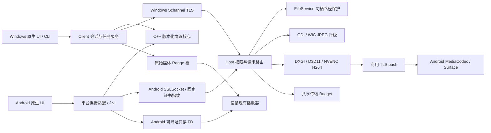

> 2026-10-15 更新：首次配置、桌面工具、目录恢复、SAF直传、发现、调度与音画共同时间轴已新增；当前结果、限制与版本兼容以 [本批报告](CONTINUATION-DELIVERY.md) 为准。下文较早的验证数字是历史记录。

# 架构、取舍与接口

## 边界与当前落地



实际代码：`core` 不依赖 Windows，提供线格式、长度校验、路径文本规则、状态转换、固定预算和 Range 解析。`win` 负责系统句柄、SHA-256、DPAPI；`tls` 管连接；`files` 管授权目录与提交；`desktop` 管实际采集/输入；`service` 管权限、消息路由和共享预算；`client` 管可恢复单文件操作与本机媒体桥。UI 通过 Client 请求业务操作，JPEG 展示是 UI 渲染适配；网络不在 Windows 消息循环中执行。

Android 共享 C++ 协议解析和封装，经 JNI 收发字节；TLS、文件描述符和 Keystore 是平台适配。**Android 的传输循环目前仍在 Java 中，尚未迁移为完整共享 C++ 任务引擎。**该差异是后续重构工作，不能宣称已共享全部业务核心。

当前已落地内置DesktopStream/NVIDIA硬件H264、AudioSource/WASAPI真实提供者；InputSession封装鼠标租约和Unicode输入。QUIC和发现仍未创建空壳实现；内置视频播放器已按用户要求移除。下一阶段新增真实实现时接入以下稳定接口，而不是在现有服务中互相调用实现细节。

## 提供者接口草案（后续契约，尚非全部已实现）

```cpp
struct ProviderCaps { uint32_t abi; /* typed feature and format limits */ };
struct FrameRef { /* owned shared GPU surface + fence, or bounded CPU view */ };
struct PacketRef { /* pool lease, timestamp, stream_id, dependency */ };
struct ITransport { /* connect, lane admission, send, receive, close */ };
struct IDesktopCapture { /* displays, subscribe, latest_frame, stop */ };
struct IEncoder { /* query formats, configure, push(FrameRef), drain, close */ };
struct IDecoder { /* query formats, configure, push(PacketRef), render surface */ };
struct IAudioCapture { /* WASAPI format, timed blocks, discontinuity */ };
struct IInput { /* scoped lease, normalized pointer, keys, release_all */ };
struct IMediaSource { /* stat_version, read_at, cancel, close */ };
struct IPlayer { /* tracks, seek, speed, subtitles, render_clock */ };
struct IExternalOpen { /* readonly cache/seekable URI, grants, lifecycle */ };
```

真正的插件 ABI 已在 `plugin.h` 实现。静态提供者可直接填充同一 `lp_api_v1` 结构；动态示例导出 `lantern_plugin_query`。当前示例是字节预览提供者，**不是音视频实现**。核心服务目前没有启用任意路径插件加载；测试程序显式加载受信任示例。生产加载器要校验类型、capability、所有函数指针、结构长度、签名/允许列表及缓冲上限。高风险解析器放独立进程，IPC 只传有界句柄与字节。对象销毁后才可关闭模块；不做热卸载。

## 关键数据流

1. 配对：本地主机生成 RSA 证书与 256-bit 随机密钥 → 用户核对 SHA-256 指纹 → TLS 中提交密钥及所需权限 → 授权会话。Windows 使用系统 [Schannel](https://learn.microsoft.com/en-us/windows/win32/secauthn/creating-a-secure-connection-using-schannel)。
2. 浏览：相对路径/分页/过滤 → 权限检查 → 实际目录句柄 → 有界枚举 → 元信息页；不启动任何采集。
3. 下载：稳定文件版本及 SHA → `.part` 与恢复记录 → 256 KiB 随机读取/刷新 → 本地 SHA → 不覆盖提交。
4. 上传：源快照/hash → 确定性任务标识 → 主机私有暂存 → 顺序分块与磁盘刷新 → 主机 SHA → 不覆盖原文件的提交。主机重启后由落盘元数据恢复。
5. 桌面：独立观看权限与连接 → DXGI GPU 采集/缓存/缩放 → NVENC H264 → 专用持续 TLS 推送 → Android MediaCodec/Surface；或显式 GDI/WIC JPEG 降级 → 最新画面槽位。没有桌面订阅时不会调用采集。隐藏显示不会停止请求。
6. 原始媒体：无哈希扫描的元信息/version → 任意 offset 范围读取 → 原字节交给外部播放器；与桌面图像质量无关。Android 的 [openProxyFileDescriptor](https://developer.android.com/reference/android/os/storage/StorageManager#openProxyFileDescriptor(int,android.os.ProxyFileDescriptorCallback,android.os.Handler)) 提供可寻址描述符。文档兼容性不确定时完整下载，再授予只读 URI。

## 通道与公平性

| 通道 | 当前策略 | 后续生产策略 |
|---|---|---|
| 输入/控制 | 独立 TLS/TCP，请求/确认有序，15 s I/O 超时 | 高优先、有界 64 条，100–500 ms 交互超时；失联释放键鼠 |
| 桌面 | 独立 TLS/TCP；硬件 push 一帧处理、256 KiB socket 缓冲和超时背压；JPEG pull 一帧在途 | QUIC datagram 或 RTP；丢旧帧、期限调度、关键帧恢复，绝不可靠重传过期帧 |
| 音频 | 独立TLS/TCP、WASAPI/PCM16；10ms帧、32KiB发送缓冲、200ms发送超时；AudioTrack约60ms预缓冲 | 压缩/datagram实时序列、小抖动缓冲/FEC，和桌面共享呈现时钟 |
| 原始媒体 | 独立可靠范围请求，最大 256 KiB；允许客户端播放器预缓冲 | 可取消范围、4–16 MiB 缓存、媒体时钟与连续预取 |
| 文件 | 独立可靠连接，单在途分块；确认、落盘与哈希 | 可恢复块位图、少量并发，自适应 256 KiB–4 MiB，可靠且有界 |

所有主机连接共用固定 40 MiB/s 名义预算，其中 bulk 使用 25%（10 MiB/s）、media 使用 50%（20 MiB/s），其余留给交互。令牌桶在所有连接间共享，不能通过多开 bulk 连接获得独立预算。文件接收也会在下一次确认前背压；未压缩原始文件内容，没有再次压缩 MP4/MKV。

**这只是 LAN 首版的固定预算，不是链路容量估计，也不是完整的跨 TCP 公平拥塞控制。**桌面和输入暂未受聚合桶计费；低于此容量的链路可能仍被占满，因此弱网不达标。下一阶段使用单一 link estimator，基于 RTT、发送队列、丢包和媒体缓冲的反馈决定总预算，再把剩余容量分给文件；不同连接也受该总预算约束。控制消息不与大文件排入同一个可靠队列。

## 线程、取消、内存与关闭

- 主机固定 8 个连接工作线程，待接连接最多 8 个。每条连接一次处理一个请求；未认证握手也受超时限制。没有每次连接永久积累的线程集合。
- 文件修改由服务互斥量串行化，操作内父目录句柄禁止删除共享，文件读取句柄禁止写共享；上传提交期间阻止客户端并发修改。删除/移动用最终文件句柄并复核文件身份。
- 网络最大逻辑帧 4 MiB；TLS 加密输入最多 128 KiB；分块最大 256 KiB；哈希缓冲 1 MiB；目录页最大 256 项、扫描最多 200,000 项；总扫描上限失败会明确报 busy。
- 硬件桌面最多两路：单线程拥有 GPU 缓存纹理、缩放目标和 NVENC 输出缓冲；无 CPU 原始像素回读。Android 一个网络/解码线程和一个有界统计/通知线程，压缩字节仍有复制，SurfaceTexture 按 UI/解码器租约释放。显示隐藏仍接收并解码，但不渲染；Surface 重建重新开会话和 IDR。停止通过原始 socket abort 解除 I/O，TLS 关闭仅在后台线程做，防止 UI 网络写入。
- JPEG 最大 16,000,000 像素和 4 MiB 编码输出。目前 CPU 图像分配存在多次复制，没有 GPU 缓冲池；这正是未达到目标的主要技术差距。
- Windows 一个业务线程和一个桌面线程；操作队列最多 16 项。状态与画面更新合并为最新槽位，窗口消息不携带无限积累的图片。
- Android 有界单业务线程（16 项），桌面使用 33.33 ms 周期预算，处理耗时计入周期，超期不补发旧帧；一次在途、一次定时任务、一个最新 Bitmap 槽位。画面更新率按唯一 Bitmap 的 onDraw 计数，有界 512 个时间戳；不等同于面板呈现或光学延迟。共享 URI 映射最多 32 项；代理 FD 的接收应用行为仍需真机压力验证。
- Cancel 在任务开始、每分块和提交前检查。哈希阶段目前不能中断；网络中断在 I/O 超时内返回，用户重试恢复。任务状态枚举/转换已定义，但持久化任务列表与完整任务引擎未实现。
- 关闭顺序：禁止新任务/订阅 → 取消任务 → 停止监听 → shutdown 活跃 socket 解除等待 → join 工作线程 → 销毁文件/证书/连接；UI 关闭也先 join 自己的线程。最坏网络等待仍可能到 15 s。

## 技术取舍与目标预算

Windows 原生 Win32 + GDI/WIC：依赖小、启动快、可编译；软件采集/编码只用于端到端基础版。本阶段已实现 Desktop Duplication → D3D11 GPU 表面/缩放 → NVIDIA NVENC → Android MediaCodec/Surface；Media Foundation/Intel/AMD 与 Windows GPU 解码待实现。参考 API：[Desktop Duplication](https://learn.microsoft.com/en-us/windows/win32/direct3ddxgi/desktop-dup-api)。系统音频独立 WASAPI loopback、时钟以 QPC/设备时钟相关映射为准。

Android 原生 Java 界面与系统 TLS/存储适配避免 Chromium/Qt 运行库；生产 UI 可以替换为 Kotlin，不影响协议。高级可选媒体包优先审查 FFmpeg、mpv/libass 组合，选择具体编译选项后单独列许可证、体积和编解码专利范围；首版没有捆绑它们。

参考验收条件：主机 Windows 11、RTX 3060/4070 或支持硬件 AVC/HEVC 的 Intel 核显；客户端 Windows D3D11，Android 12+ Snapdragon 8 Gen 2 级别、HEVC Main10 硬件解码。千兆有线 RTT≤3 ms，或 Wi-Fi 6 可用吞吐≥150 Mbps、RTT≤10 ms。

- 1080p60 AVC 桌面：目标 12–25 Mbps，采集≤4 ms、硬编≤6 ms、排队/网络≤15 ms、解码≤6 ms、呈现≤17 ms，端到端目标 p95<80 ms。预算总和与端到端必须分别实测；首版未达此目标。
- 4K HEVC Main10 23.976/60 fps：素材 40–100 Mbps，目标首帧<2 s、正常拖动<1.5 s、10 分钟连续播放无重缓冲；预缓冲 2–5 s，ASS 复杂字幕需另测。HDR 必须协商显示、解码及色彩路径，否则明确 SDR 降级。首版只传原字节，无 HDR 色调映射。
- 目标核心安装<15 MiB、冷启动<500 ms、空闲内存<40 MiB；真实包大小与启动验证见报告，不能以文件体积替代安装实测。

全屏输入改用共享DesktopViewport几何数据，JPEG/TextureView/输入三者同源；不从无drawable的ImageView取矩阵。Android输入另有单线程和32项有界队列、专用控制权限TLS连接，文件工作线程不参与输入。移动合并为一个最新槽位；服务器InputSession拥有鼠标租约，250ms客户端心跳和1800ms主机过期释放，独立50ms检查线程。原生RemoteKeyboard只在本地维护组合文字，提交后走Unicode输入消息；焦点检测不读取内容。完整修饰键与旧式输入状态表待实现。

系统音频由AudioSource/WASAPI内置提供者产生PCM，服务层只负责授权/协议/背压。Android独立SystemAudio线程拥有网络、AudioTrack和音频焦点；80ms请求缓冲、约60ms预缓冲、一个在途10ms包。音频订阅不依赖DesktopView/MediaCodec生命周期；Activity离开前台时停止。真实样本不持久化，debug能量统计显式启用且有计数重置上限。没有音画共同呈现时钟。


2026-10-14 后续实现与验证已更新：[文件、媒体、音频交付报告](FILES-MEDIA-AUDIO.md)。早期“未实现”条目请与该报告对照；完整产品仍未完成。


2026-10-14 最新：主机Config-v2支持最多64个独立设备凭据/权限与会话generation、单设备撤销和结束现有连接，TLS协议v1保持兼容，旧Config-v1读取迁移；设备管理为CLI，详见DEVICE-TRUST.md。剩余实现及未验证项以REMAINING.md为准。


## Windows客户端本轮落地

windows_playback.cpp提供不透明PImpl的WindowsVideo/WindowsAudio：MF H.264/DXVA GPU样本直接接D3D11视频处理器/交换链，Opus或PCM接WASAPI。windows_client.cpp提供分页/搜索/主机任务解析、DPAPI凭据与32项单工作线程恢复队列；windows_tree.cpp负责有界目录快照/校验/提交；windows_media.cpp负责可关闭的4工作线程回环原始Range桥。Win32四页UI使用这些公开接口，网络/输入/文件/音频/桌面有独立工作线程，不访问Schannel/DXGI解码实现内部。当前部分业务循环和协议组包仍在GUI.cpp，继续拆出统一Session服务列为剩余工作，不宣称架构边界全部完成。真实数据和关闭次序见WINDOWS-CLIENT.md。

Windows本批增量：windows_clipboard.cpp通过ClipboardAccess默认原生提供者实现可取消的独立文本同步；windows_thumbnail.cpp抽出WIC PixelImage解码及单worker/最新候选的缩略图服务，UI只显示带代际结果。WindowsTransfers v3保存限速和优先级，整批上传一次journal提交并可回滚入队；派发优先级不抢占，活动策略唤醒等待。原始媒体桥开启信号参与保守文件上限2MiB/s，还不是全链路容量估计。资源及实际验证见WINDOWS-INTERACTION-TASKS.md。

2026-10-14 后续交付：本机Windows主机/授权/连接管理已接通，HostAdministration API-v1及本地无凭据HostSession接口，不增加网络管理员协议。安卓真Wi-Fi补测授权12项、文件/外部打开37项通过；本轮只重跑受影响的3套原生测试。当前使用与限制以HOST-MANAGER.md为准；旧性能数字不视为本轮复测。
