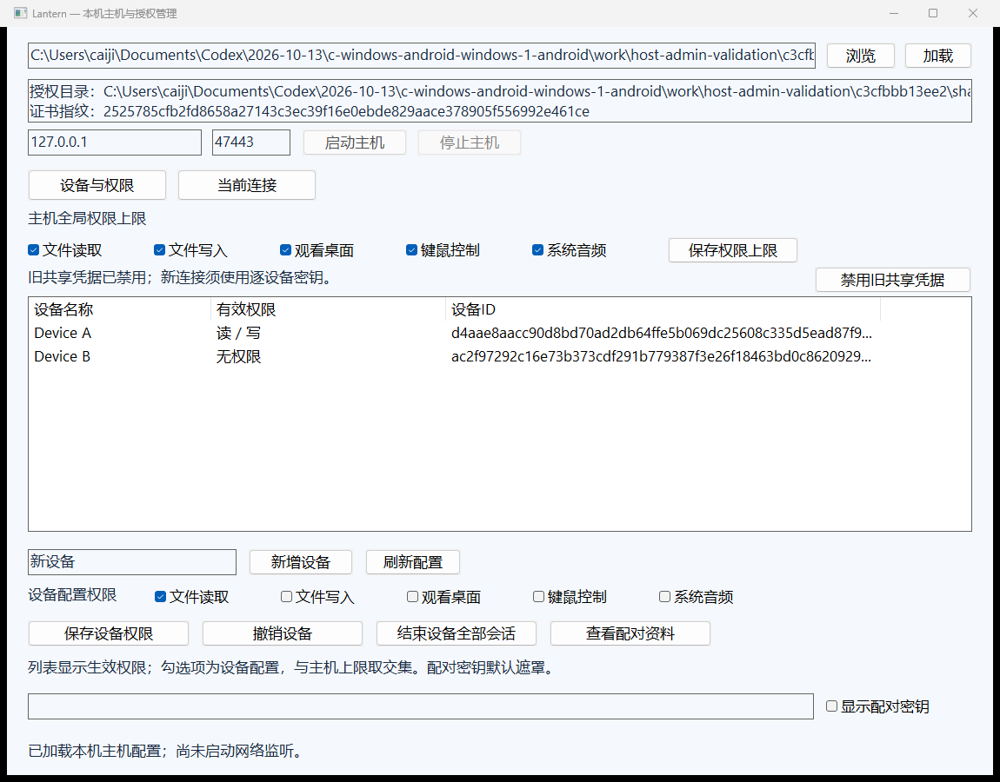
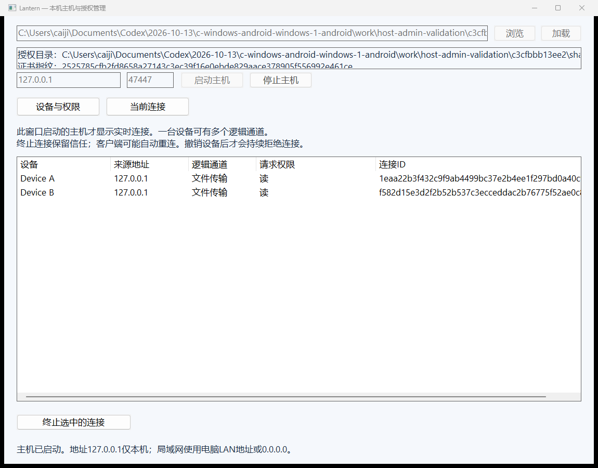

> 2026-10-15 更新：首次配置、桌面工具、目录恢复、SAF直传、发现、调度与音画共同时间轴已新增；当前结果、限制与版本兼容以 [本批报告](CONTINUATION-DELIVERY.md) 为准。下文较早的验证数字是历史记录。

# 本机主机管理与安卓兼容补测（2026-10-14）

已新增可运行的Windows原生主机管理程序`lantern-host.exe`，客户端设备页也可点“管理本机主机”打开。新增文件是实际DPAPI配置管理和Host会话管理接口，不是界面占位。安卓设备PKR110/Android16已连接，原先延后的主机兼容测试已补；APK和内置视频播放器移除状态不变。完整产品仍未全部完成。

## 使用

1. 结束同一端口上原来的CLI主机（Ctrl+C），再打开本机管理程序。输入原主机状态目录，或“浏览”选择其中的config.dpapi，点“加载”。必须同时存在原identity.dpapi，且属于当前Windows用户；不要选择客户端偏好目录，也不要重新init已有状态。本窗口不自动创建/替换身份和共享根。
2. 确认证书指纹和授权目录。加载配置不会启动网络监听；默认127.0.0.1只供本机。手机访问时将监听地址改成电脑LAN IPv4或0.0.0.0，确认端口后点“启动主机”。端口占用/权限/配置错误会显示实际失败原因。关闭窗口会停止它启动的主机，不会终止其他进程启动的主机。
3. 设备页可新增设备，分别勾选文件读取、文件写入、观看桌面、键鼠控制、系统音频。初始只选文件读取。每个设备使用独立随机密钥，DPAPI保存；资料查看默认遮罩，明确勾选才显示，不自动写剪贴板或日志。刷新和关闭会清空密钥显示。
4. **切换为可写**：在“主机全局权限上限”勾选文件写入并保存；选择相应设备，在设备配置权限勾选文件读取、文件写入，点“保存设备权限”。手机原连接可能因权限变更而结束，重新连接即可。列表显示生效权限，勾选项是设备配置权限，最终权限取两者交集；降低上限不会丢失设备原配置。
5. “结束设备全部会话”保留信任，客户端可以重新连接；“撤销设备”会持续拒绝该密钥。禁用旧共享凭据只影响旧密钥，逐设备信任保留。不可将结束会话当成撤销信任。
6. “当前连接”展示此窗口管理的Host中已认证的真实连接，包括设备、IPv4、逻辑通道、请求权限与连接ID，1秒刷新。一个设备可以有多个通道。“终止选中的连接”只关闭这一条并取消其主机文件任务，其他连接保留；客户端可能自行重连。现有其他CLI进程的连接不会被伪造显示为已读取。

初次创建主机仍使用现有CLI：`lantern.exe init STATE E:\Anime 31`，这是显式选择目录和全局上限；当前管理窗口只管理已有配置。首次配置向导、无人值守/锁屏服务、短码/二维码配对仍未实现。

## 实现与边界

`HostAdministration`是本地API-v1，封装配置读取/新增/授权/撤销/会话代数/旧密钥禁用/明确读取配对资料，修改复用原有互斥、原子DPAPI快照。普通设备摘要不含token，分别保留配置权限和有效权限。没有新增网络管理员权限或远程管理端口。

`Host::sessions`返回无凭据的已认证连接摘要；`Host::end_session`按随机连接ID匹配，锁内shutdown并取消关联文件任务，避免误杀同设备兄弟连接。新窗口拥有Host、监听和线程，停止期间继续泵UI，服务结束后join再销毁。CLI主机兼容性和现有网络协议保持不变。主机仍是当前登录桌面中的应用，不是Windows系统服务。

## 本轮实际验证

| 检查 | 实测结果 |
|---|---|
| 新主机管理后端 | 24项：DPAPI、唯一凭据、非法标签/权限、配置与有效权限、真实3条TLS连接、精确终止/兄弟连接保留、全设备结束/撤销/旧密钥禁用 |
| 新管理窗口 | 19项，含真实配置操作、两个真实TLS客户端、终止一条、改权限关闭另一条、撤销/禁用旧凭据、密钥遮罩/清空、完整可选择指纹、运行主机时退出；含截图检查 |
| 受影响的原生回归 | 只运行host_admin、device_trust、integration三套，全部通过，4.69秒；没有把其余套件声称为本轮重新执行 |
| 安卓授权兼容 | 12项通过，独立密钥、真实写入、降为只读、结束/撤销及其他设备保留 |
| 安卓文件/外部打开兼容 | 37项通过：目录/搜索/缩略图、暂停/恢复/SHA/队列、SAF、原始URI随机读、系统chooser及已有手机播放器前台 |
| 网络 | 真Wi-Fi LAN，手机192.168.31.137 → PC192.168.31.58；USB只用于调试，未用adb reverse承载业务 |
| APK | 未改代码/未重建；测试install-r同一APK，测试finally恢复原偏好和任务日志，测试主机全部退出 |

初次外部播放器测试参数误传包名，35项后在组件名校验失败；已解析真实组件com.coloros.video/com.oplus.video.ui.LocalVideoPlayActivity并修正，相关文件测试通过37项。Python入口新增完整组件格式前置检查，防止做到最后才失败。失败记录保留在work，不作为通过结果。UI最后只修整指纹文本区域并做定向截图复核，没有再重复音视频或全量测试。

报告见host-admin.json、host-admin-gui.json、android-host-admin-trust.json、android-host-admin-files.json。原生回归没有重测GPU帧率、光学延迟、音画同步、弱网、热量、长稳或电影HDR/ASS，旧音视频性能报告属于历史记录。原始媒体使用生成的4K HEVC Main10短片验证URI与外部应用打开；本轮**没有测4K播放帧率/首帧/长影片流畅度**。

复现本轮原生检查：

```powershell
cmake --build <构建目录> --config Release --parallel 4
ctest --test-dir <构建目录> -C Release -R "^(host_admin|device_trust|integration)$" --output-on-failure
<构建目录>\Release\host_admin_tests.exe <验证输出目录>
# 使用上条Fixture目录；GUI测试会修改自己生成的设备配置，每次复现先生成新fixture。
python tests\host_admin_gui.py --build <构建目录>\Release --fixture <Fixture目录> --output <新的输出目录>
```

当前可配置11套CTest（含JDK17的4套Java/JNI）；没有JDK配置时为7套原生。本轮只重跑上述3套，上批完整10套通过记录保留。





剩余实现与验收缺口继续见REMAINING.md；不能把本轮交付当成全产品完成。
