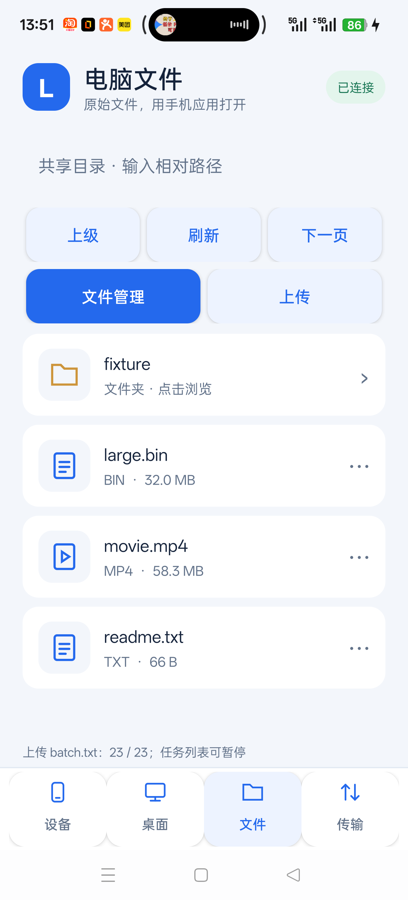
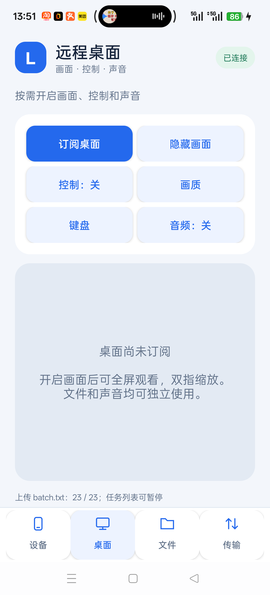
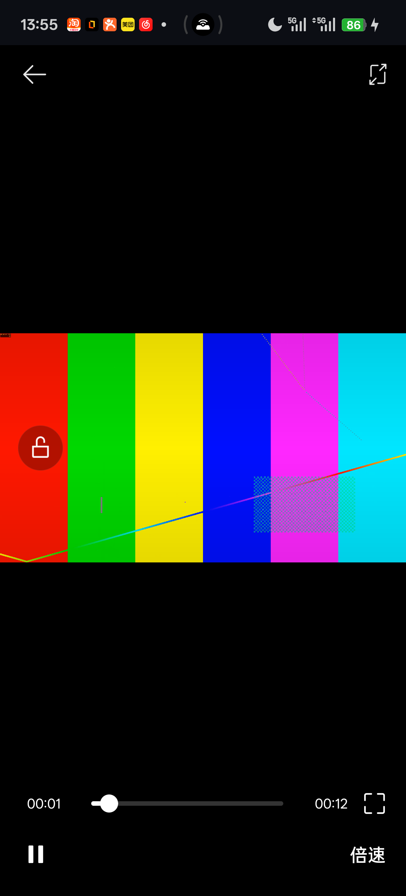

# 安卓四页界面与外部应用打开（2026-10-14）

后续后台传输/自动恢复/冲突处理已实现，最新状态见 [BACKGROUND-RECOVERY.md](BACKGROUND-RECOVERY.md)。这是可构建的版本；完整产品尚未完成。内置视频播放器按用户要求删除，不再作为待实现项。先前 MediaPlayer 的 4K 首帧/拖动记录仅是历史数据，不代表当前手机外部播放器性能。

## 手机使用

底部「设备」填写电脑 IPv4、主机指纹和配对密钥，点击「连接电脑」。可使用 `IPv4:端口`，默认47443。配对信息仍使用 Android Keystore 加密保存。连接成功后自动进入「文件」。首次需核对指纹；配对密钥不会放入任务记录。

访问 `E:\Anime`：电脑主机必须已经将此目录设为授权根目录。手机文件页的空路径就是该根目录，无需填写 `E:\Anime`，点击文件夹继续浏览；路径框只接受授权根下的相对路径。主机配置命令见 README，状态目录须放在共享根之外。

点击动漫文件选择「用手机应用打开」，再从系统选择器选择播放器。Lantern 提供只读、可随机定位的 content URI，按需读取原始文件；不经桌面编码、不再次压缩电影。播放器不支持该 URI 时选择「下载后打开」，待下载和 SHA256 校验完成后交给播放器。音轨、字幕、倍速、全屏、进度和连续播放由所选手机应用处理，兼容性取决于该应用；本轮未验收 ASS、HDR、外挂字幕、长影片或任意播放器。

「文件管理」提供搜索、排序、批量选择和目录操作；长按文件/目录执行重命名、主机内复制/移动、删除、信息、缩略图或下载。主机内操作仍直接在电脑执行。「上传」可选择手机文件或整个目录。

「传输」独立显示上传/下载进度，点击任务暂停、继续或打开已完成文件。「任务与限速」提供队首优先、取消和清理缓存。任务机制、原件保护和暂存提交方式没有改动。

「桌面」集中提供画面订阅、隐藏、控制、画质、键盘和音频。订阅后点击画面右上角「全屏」。全屏内「工具」可直接开启控制、音频或键盘；「文件」直接返回文件页。横竖屏、双指缩放、单指拖拽和电脑双击保留。切换到文件页保持画面订阅，减少布局重建；若要停止电脑采集/传输，需要关闭订阅。隐藏画面也不是主机隐私屏。返回键先收起输入法，再退出全屏。

## 代码与构建

AppShell 是原生 Android 展示层，负责导航、卡片、文件行和任务进度；网络仍经既有 Remote 接口，文件管理、传输队列、H.264 桌面与音频拥有各自生命周期。DesktopLayout 保持同一画面父视图及已附着的 Surface，全屏/页面切换不重新创建编解码器。

PlayerActivity 及其清单注册已删除。RemoteFileReader 保留有界2 MiB随机读缓存与源版本校验，供 FilesProvider 使用；不再继承 MediaDataSource。FilesProvider 仅暴露只读 URI 和临时读取权限，远程代理 FD 上限8，活动代理期间为文件传输保留观影带宽预算。已完成队列缓存可交给外部应用打开。Android 仍需要 MediaCodec 解码远程桌面与 Opus 系统音频，这些功能保留。

构建命令仍见 README。独立 Android 构建每次使用新的 Java class 输出目录，避免删除的播放器类残留到 APK。测试签名与 applicationId 保持不变，`adb install -r` 保留原配对及数据。测试运行前保存用户配对偏好和任务日志，结束后恢复；业务测试使用单独47444端口及生成文件，不修改用户 Anime 目录。

## 真机验证

条件：Windows i5-14600KF / RTX4070SUPER，OnePlus Ace5Pro PKR110、Android16/API36；同一 WLAN，业务连接10.217.43.110:47444，USB仅用于安装调试。没有网络限速或丢包注入。下列均为实测，不是目标；截图仅展示生成文件。

| 验证 | 结果/证据 |
|---|---|
| Windows 构建与单元/协议测试 | 6个ctest套件通过：core、integration、file_features、pacer、viewport_mapping、java_interop |
| 文件管理/任务/原始外部URI | ui-files-external.json：37项；文件/目录复制删除、SAF目录与多文件上传、实际暂停/恢复、落盘日志恢复及SHA256；移除播放器清单注册；四页截图与真实系统打开方式选择器 |
| 手机已有播放器打开 | com.coloros.video 手机自带播放器实际打开了远程只读URI，截图可见生成的4K Main10/30fps测试图案与00:01播放进度（12秒影片）；这是可打开并显示画面的观察，未测首帧时间、呈现帧率、seek延迟或长影片稳定性 |
| 全屏坐标与工具内控制 | ui-fullscreen-control.json：13项；横屏中心/四分位、缩放平移、竖屏及JPEG五点，实际Windows坐标误差均0像素 |
| 拖拽/双击/输入法 | ui-interaction-regression.json；独立Windows测试窗口实际移动、双击事件、输入法与中文/emoji提交、取消/断线/租约超时释放鼠标，未向用户其他应用发送测试输入 |
| H.264及新页面切换 | ui-h264-regression.json：23项；1080p，系统c2.qti.avc.decoder硬解；10秒窗口解码呈现回调59.90/s、TextureView更新53.40/s；横竖屏、双指缩放、双击不缩放、文件页切换保持连接；32 MiB并行下载10.085s |
| Opus独立音频及并行 | ui-audio-regression.json：13项；编码负载0.095995Mbps；实际4秒播放帧增量192000、稳态underrun增量0；H.264/音频/32 MiB下载并行10.039s、underrun增量0；停止13.54ms |

呈现回调和TextureView更新不等于屏幕光学帧率，未宣称完整1080p60验收。音频没有共同呈现时钟/声学延迟数据。外部URI随机读通过不等于外部播放器任意格式播放通过。当前包大小和SHA256以外层 artifact-manifest.json 为准。

仍需推进：后台传输、网络切换自动恢复、同名冲突选择、逐设备身份、Windows新功能界面和硬解音频、SAF免复制上传、小文件协议效率、链路整体公平、音画同步，以及弱网/长影片/热量/长稳实测。用户已取消06:00续做定时任务，本次不创建自动化。
