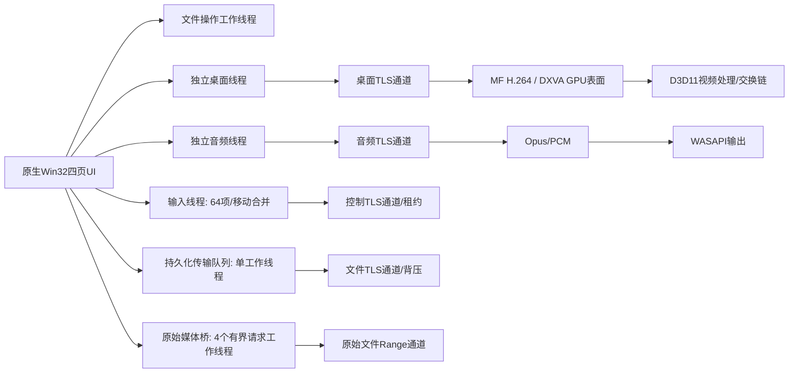
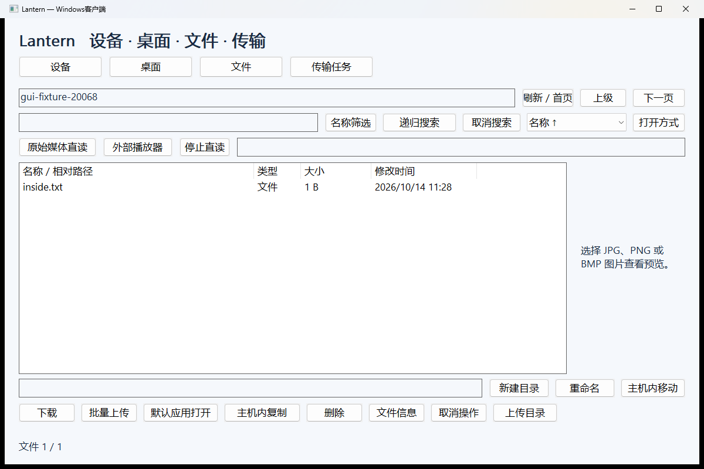
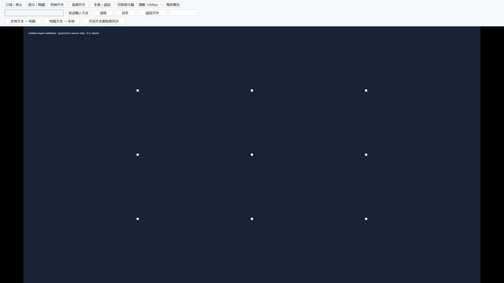

> 2026-10-15 更新：首次配置、桌面工具、目录恢复、SAF直传、发现、调度与音画共同时间轴已新增；当前结果、限制与版本兼容以 [本批报告](CONTINUATION-DELIVERY.md) 为准。下文较早的验证数字是历史记录。

# Windows客户端交付与验证（2026-10-14）

**最新交互增量已交付：** 文本剪贴板、图片预览、多文件上传与任务限速/优先级，见[增量报告](WINDOWS-INTERACTION-TASKS.md)。

本轮把原来的JPEG/点击演示客户端升级为可运行的Windows原生客户端。完整产品仍为实验版本；Android未恢复内置视频播放器。本文件与 `windows-client.json`、`windows-gui.json` 是Windows客户端的最新说明，早期首版表格属于历史记录。

## 使用

解压Windows ZIP，运行 `lantern-client.exe`。主机继续使用 `lantern.exe`；已有授权目录、身份文件和配对不需要重新初始化。升级时先在主机终端Ctrl+C结束旧版本，再运行新主机，避免旧主机不支持新增输入操作。

1. **设备**：输入电脑局域网IPv4地址，可附 `:47443` 或自定义端口；核对主机SHA-256指纹，输入分配给此客户端的设备密钥，点“验证并保存”。配对资料仅在当前Windows用户下用DPAPI加密保存。
2. **文件**：路径填写共享根的相对路径，根目录留空。刷新/首页、下一页、上级、名称筛选、递归搜索与取消、名称/大小/时间排序均走独立文件接口。没有桌面订阅也能使用。
3. **传输任务**：选择文件或目录后点下载；多选文件可一起下载到指定本地目录。上传文件、上传目录分别选择本地来源。任务页可暂停、继续/重试、移除记录、另存新目的地、打开已下载文件。上传另存时在任务页右侧填新的远程相对路径，下载另存使用系统保存对话框。移除记录不删除已经接收的临时数据。
4. **桌面**：订阅、显示/隐藏、控制开关、音频开关分别操作。三档请求为1280宽/30fps/4Mbps，1920宽/60fps/8Mbps，1920宽/60fps/12Mbps，实际高度随显示器比例变化。条件不支持DXGI/NVENC或D3D11硬解时明确降级JPEG。
5. **全屏**：F11或“全屏/返回”进入全屏，工具按钮直接保留在全屏窗口内；Esc或同一按钮返回。点“返回文件”退出全屏并打开文件页，桌面订阅继续保持。Ctrl+滚轮中心缩放1–3倍，“缩放复位”回到适应窗口；双击用于远程Windows双击，不缩放。
6. **输入**：画面内可点击、拖拽、右键、滚轮；拖拽有心跳及租约释放。可直接输入普通字符，或在桌面工具栏文本框用本机输入法输入中文/emoji并点击“发送输入文本”。导航键、Ctrl/Alt组合键与功能键走原子输入，常用组合可从右侧下拉菜单发送。F11和全屏Esc由本地界面保留，Windows系统截获的Win组合可用下拉入口。Ctrl+Alt+Del明确不支持，未实现锁屏安全桌面服务。

如果共享根是 `E:\Anime`，文件页根目录就直接显示里面的动漫；不再输入 `E:\Anime`，也不必先点桌面订阅。创建新的主机状态时可参考：

```powershell
.\lantern.exe init .\state E:\Anime 31
.\lantern.exe device-add .\state "Windows客户端" 31
.\lantern.exe host .\state 0.0.0.0 47443
```

`31`显式授予读1、写2、观看4、控制8、音频16的组合；只访问文件可使用1，其他操作会明确被拒绝。CLI在本机输出一次设备指纹和密钥，请核对后填入客户端，不写入共享文件或日志。已有状态不要再运行init；设备密钥受主机全局权限上限限制，详见DEVICE-TRUST.md。

## 原始视频和文档打开

- 大视频：文件页选择MP4/MKV后点“原始媒体直读”，获得仅在当前电脑回环接口有效的随机地址。可复制到现有播放器“打开网络地址”，或点“外部播放器”选择已安装的播放器exe，Lantern把地址作为一个参数传入。播放器必须支持HTTP Range；暂停、拖动、容器/HEVC/10-bit/HDR/ASS/音轨等由它处理。接收应用不兼容时，下载完成后再用本机播放器打开。
- “停止直读”、开启另一文件的直读或关闭客户端会结束旧服务；旧地址失效。不要把该临时地址当作公网分享链接。桥只传原始字节，不重编码、不内置播放器，不保证所有播放器能直接打开该URL。
- 文档或小视频：“默认应用打开”/“打开方式”先完整下载并校验，再调用Windows默认应用或系统打开方式。缓存按文件版本隔离，单文件512MiB、总量2GiB；传输单工作线程在每个缓存下载开始前检查剩余容量，超出时任务明确失败，排队不能突破软件写入上限。暂没有自动生命周期清理，可在所有外部应用退出后清理 `%LOCALAPPDATA%\Lantern\client\cache`。编辑不会自动回传。
- 外挂字幕及MKV字体附件的跨应用共享尚未接入；内嵌字幕是否可用取决于接收播放器。此轮验证原始Range读取，并未实测Windows外部播放器4K首帧、HDR或长影片。

## 文件与安全语义

新建填写名称；主机内复制、移动、重命名在文件页下方输入完整的共享根相对目的路径。例如把 `Season1/a.mkv` 移动到 `Archive/a.mkv`；父目录需已存在。复制/删除目录使用主机后台任务，文件内容不绕经客户端；可以取消，删除可能已经删除部分内容。删除有确认，不隐含回收站恢复。

单文件传输以256KiB块和SHA-256工作，下载的 `.lantern-part` / `.lantern-resume` 与最终文件分离。上传复用主机临时任务；同名且完整内容相同可幂等完成，不同内容报冲突。任务日志DPAPI加密，最多32项，任务绑定原始设备凭据，修改设备页不会把旧任务发送给新主机。启动后未完成任务统一暂停，手动继续。普通网络错误有限重试0.5–30秒，最多10轮；证书、身份、路径、源版本、校验及磁盘错误不会当作断网无限重试。

目录任务保存至多10000条、深度32层、1MiB的版本快照，拒绝本地重解析点及不安全相对路径。下载在独立目录stage逐文件校验，复核源目录/文件版本后才改为最终目录名，暂停时不出现半成品最终目录。上传逐文件校验提交，**不是目录整体原子提交**，失败时目标可能已有部分文件；不允许采用其他已有目录来隐含覆盖。目录另存生成新任务标识，保留旧stage供用户检查或清理。下载仍依赖单文件Flush/SHA，不含小文件合并协议。

## 模块与资源



UI文件操作队列16项、结果队列32项，JPEG仅一个最新画面槽位；输入队列64项且合并相邻移动。TLS协议帧上限4MiB，文件分块256KiB，媒体桥4请求/请求头8KiB/一个在途块/本地读写10秒超时。GPU画面不做CPU像素回读；解码样本在当前帧处理后释放。WASAPI共享模式采用100ms缓冲、超过80ms积压重置；没有共同音画时钟。

桌面、音频、文件任务、输入有各自连接和关闭路径；网络故障重建解码器/播放器，控制会关闭且输入不重放。文件在桌面或音频订阅时上限4MiB/s、空闲32MiB/s，按实际新传输的字节计费，恢复偏移及已校验文件不重复占用节流预算。原始媒体桥开启时文件上限2MiB/s，用户限速只能降低；当前尚未参与全链路容量估计；整体公平、自适应码率与QUIC仍待完成。

关闭先取消/中断连接，停止队列，释放解码/输出，再销毁HWND。关闭期间继续泵UI消息，避免DXGI跨线程窗口消息与UI等待形成死锁；实际带GPU连接关闭已验证。系统输入、剪贴板、音视频样本和配对密钥不写日志。没有运行时热卸载。

Windows硬解遵循微软的[H.264解码器](https://learn.microsoft.com/en-us/windows/win32/medfound/h-264-video-decoder)和[D3D11设备管理](https://learn.microsoft.com/en-us/windows/win32/medfound/supporting-direct3d-11-video-decoding-in-media-foundation)接口。可选Opus静态链接BSD代码，未捆绑FFmpeg、VLC、mpv或办公套件。

## 真实验证与边界

参考机器：i5-14600KF、RTX4070 SUPER、Windows11；本轮Windows主机/客户端运行于同一电脑，Schannel TLS经127.0.0.1，不能代表两台电脑的LAN带宽、跨网络时延或不同GPU性能。

结果以 `windows-client.json` 和 `windows-gui.json` 的最新实测为准：

- 原生套件：独立分页/排序/搜索/取消、目录变化、路径拒绝、主机复制/删除、任务日志、双向SHA、暂停续传、真实主机停止/重启恢复、身份失败、冲突另存、目录快照恢复、HTTP Range/HEAD/越界/nonce/Origin限制。
- 硬件短测：1080p H.264，300帧，真实DXVA GPU表面及GPU呈现，途中改变窗口大小、纵向比例及1.5倍缩放，16MiB限速下载并行完成。报告的是解码与Present调用率，**不是屏幕扫描输出帧率、光学延迟或长期稳定60fps验收**。
- 音频短测：实际WASAPI接收24000 PCM帧；可选Opus实际解码并输出、预跳过及坏包上限验证。样本为生成静音，证明输出管线运行，未测声音质量、声学延迟、长时欠载或共同音画同步。
- 原生GUI：独立页、配对密码遮罩、H.264连接、原始媒体读、全屏保留工具/返回文件、真实纵向窗口、全屏三处真实鼠标误差≤2px、Windows双击、实际窗口拖拽180×85px（误差≤3px）、中文/emoji进入生成的原生编辑框、带GPU连接关闭。

可重复运行（先构建，未使用用户共享目录或个人文件）：

```powershell
.\build.ps1
..\..\work\lantern-build\Release\windows_client_tests.exe ..\..\work\windows-client-validation --media
# 从命令输出Report的父目录取生成fixture，例如 ...\windows-client-validation\<随机ID>
python .\tests\windows_gui.py --build ..\..\work\lantern-build\Release --fixture <生成fixture目录> --output ..\..\work\windows-gui-validation
```

`--media`需要真实NVIDIA主机编码/D3D11解码/可用音频端点；不支持时返回失败，不模拟成功。常规CTest中的Windows任务/协议套件不要求硬件编码。GUI脚本只驱动它启动的程序，主机输入限制到生成画布PID。测试服务结束后清理自己启动的进程；截图只发布生成画布及测试文件。

剩余Windows侧：显示器系统分辨率切换、GPU设备丢失后完整恢复、混合DPI/多机兼容矩阵、原始媒体公平调度、锁屏/无人值守服务、签名安装器及完整性能验收。其他产品缺口见REMAINING.md。

## 本轮最终数字

| 项目 | 实测结果 |
|---|---|
| 原生功能/协议检查 | 351项（包含300次逐包序号验证） |
| GPU解码/呈现 | 300/300帧，4.99886秒，Present调用率60.014/秒；CPU回读画面0 |
| 并行文件 | 16MiB限速任务完成并通过SHA-256 |
| WASAPI | PCM实际提交24000帧；另验Opus真实解码/输出 |
| GUI | 40项，新增图片预览/批量上传/任务策略，包含纵向窗口与真实全屏坐标/拖拽/双击/Unicode |
| GPU活动时关闭 | 63.00ms（本轮单次测量） |
| 未测 | 两机LAN、光学延迟、GPU利用率/显存、精确AVsync、外部4K长影片/ASS/HDR、长稳 |





2026-10-14 后续交付：本机Windows主机/授权/连接管理已接通，HostAdministration API-v1及本地无凭据HostSession接口，不增加网络管理员协议。安卓真Wi-Fi补测授权12项、文件/外部打开37项通过；本轮只重跑受影响的3套原生测试。当前使用与限制以HOST-MANAGER.md为准；旧性能数字不视为本轮复测。
