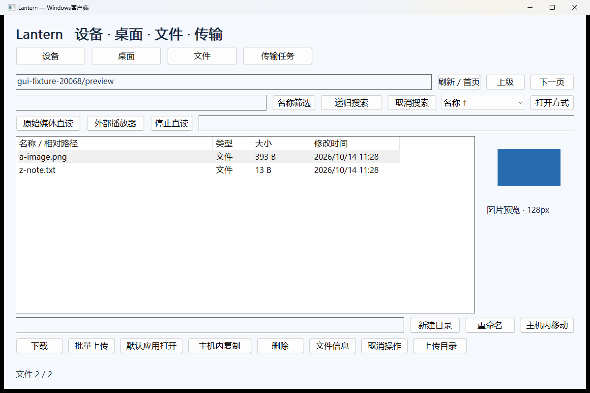
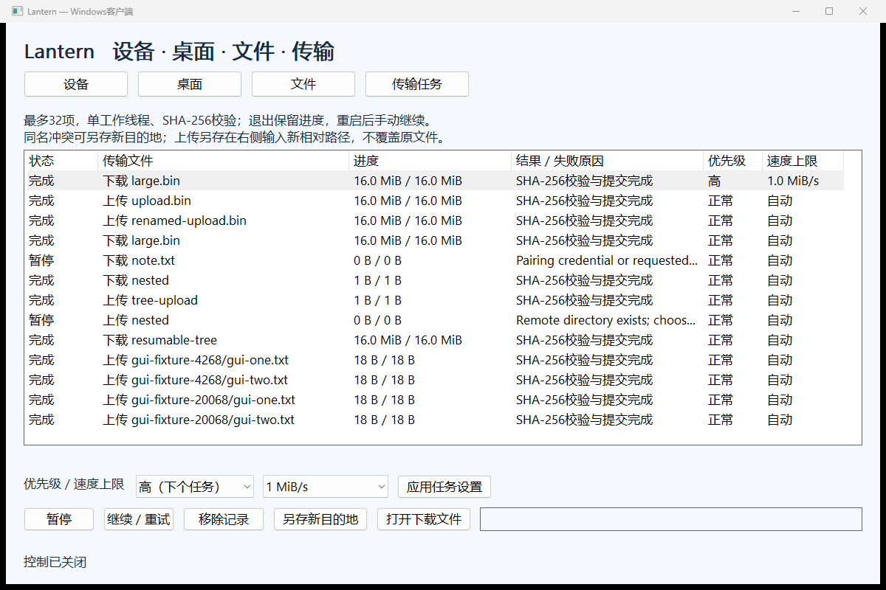

# Windows交互与传输增量交付（2026-10-14）

本批已完成并构建：文本剪贴板、图片缩略图、多文件上传、任务限速和优先级。内置视频播放器继续保持移除。Android源码/APK未改；用户暂时关闭USB，本轮没有安卓真机测试，旧真机报告属于历史证据。完整产品仍未完成。

## 使用

升级Windows主机和客户端可执行文件，保留原有状态目录。先在原主机终端Ctrl+C退出，再启动新版本，不需要重新初始化授权目录。旧主机缺少剪贴板操作，调用会返回错误。

- 桌面页“本地文本 → 电脑”和“电脑文本 → 本地”可单次复制文本，无需订阅画面或开启鼠标控制；设备需要主机授予control权限。“开启文本剪贴板同步”明确选择双向同步，初始内容保持不变。两端同时修改且内容不同会停止同步并保留两边，手动选择复制方向后可重新开启。停止/换设备/退出会中断同步；普通网络错误也会停止并显示原因。只支持UTF-8文本最多64KiB，包括空文本、中文、emoji；图片、文件剪贴板和历史不支持。剪贴板内容不写日志或任务文件。
- 文件页选择JPG/JPEG/PNG/BMP，右侧异步显示最大128px预览。非图片、权限拒绝、文件变更和格式失败会明确提示。快速切换只保留当前请求和最新候选，旧结果不会替换新选择。不包括视频/办公缩略图。
- “批量上传”使用Windows原生文件选择器，Ctrl/Shift多选，一次1–32个普通文件，上传到当前显示的远程目录。整批先检查来源/目的地/剩余32项容量，再一次提交DPAPI任务日志；重复目标、无效文件、容量不足或日志失败不会只入队半批。文件真正上传依次执行、逐文件校验提交，不是整批事务，后来失败的任务会保留失败原因及已经完成的文件。
- 传输页选中任务，选择低/正常/高优先级及自动/64KiB/s/1、4、8、16、32MiB/s，然后点击“应用任务设置”。优先级作用于下一次派发，最高优先级优先，相同优先级按加入顺序；不抢占正在运行的任务。限速变更唤醒分块等待，恢复偏移和已存在相同文件不重复计费。

## 调度和资源

队列仍为单工作线程、最多32项。空闲文件传输上限32MiB/s；桌面或音频订阅时4MiB/s；原始媒体直读桥开启时2MiB/s，即使尚未有播放器读取也采用这个保守上限。用户设置只能降低这些上限。按真正新增文件payload节流，256KiB分块允许短暂分块突发；这些是应用上限，不是带宽承诺，也未构成跨连接/跨客户端的完整拥塞和公平控制。

任务日志v3保存priority和rate_limit，可读取v1/v2；未完成任务重启为暂停，策略保留。旧客户端不能读取v3任务日志，降级前应另行保留旧状态备份。传输协议/HELLO仍v1，Android旧客户端的既有操作不变。

新稳定模块：`ClipboardSync`拥有独立线程/取消代际/文本CAS；`ThumbnailLoader`拥有单线程/当前与最新候选/连接中断/代际结果；`PixelImage`和WIC解码从GUI抽出。默认剪贴板提供者是Windows原生实现；测试可注入接口，部署没有模拟剪贴板开关。静态图片位图和系统控件可能产生的副本均在替换/关闭时释放。

## 真实验证

参考设备i5-14600KF、RTX4070 SUPER、Windows11。Windows主机/客户端均在同一电脑，TLS经127.0.0.1；不能代表两台电脑局域网或弱网性能。

| 项目 | 结果性质 | 本轮结果 |
|---|---|---|
| 完整CTest | 实测 | 10套全部通过，含协议/路径/恢复/插件/Java互操作与新增Windows功能套件 |
| 新增功能套件 | 实测 | 48项：原生隔离剪贴板文本/CAS/权限/版本/64KiB边界；同步初始保留/方向/无回声/停止/冲突；预览WIC/格式/上限/替换；批量上传/容量/日志失败回滚；优先级/动态限速/日志兼容 |
| 2MiB下载，设置1MiB/s | 实测 | 2.29638秒，包含TLS/磁盘/校验开销 |
| 活动限速64KiB/s切回自动 | 实测 | 215.235ms后测试任务完成，旧4秒分块等待被唤醒 |
| 原生GUI | 实测 | 40项，包括真实系统多选文件对话框/两个上传结果、预览显隐/8次替换GDI句柄有界、任务策略保存，以及全屏/纵向/坐标/拖拽/双击/中文与emoji回归 |
| H.264短测 | 实测 | 300解码/300Present，4.99886秒，60.0137次Present/秒；CPU画面回读0，16MiB限速文件并行SHA通过；351检查包含300次序号验证 |
| 音频短测 | 实测 | WASAPI提交24000 PCM帧，另验Opus真实解码/输出；生成静音样本，不代表声学质量或AV同步 |
| 有GPU订阅时关闭 | 实测 | 63.00ms，一次测量 |
| Android真机 | 本轮未测 | 用户要求下次再测，APK不变；Windows上的Java互操作仍通过 |

剪贴板验证没有访问用户交互桌面的剪贴板：原生主机在系统允许的非交互窗口站中运行，测试会先拒绝带WSF_VISIBLE的窗口站。同步状态机使用独立的内存客户端提供者，对端为真实TLS/原生Windows剪贴板；**未测两台真实Windows电脑的自动剪贴板同步**，不能把注入提供者当成第二台真实设备。普通用户不能创建命名窗口站，测试选用非交互系统窗口站，依据[微软CreateWindowStation说明](https://learn.microsoft.com/en-us/windows/win32/api/winuser/nf-winuser-createwindowstationw)。

可重复执行：本机10套包含配置JDK17后的4套Java/JNI互操作与状态测试；新构建目录若未设置LANTERN_JNI_TEST_JDK只运行6套原生测试。要复现10套，先使用CMake的`-DLANTERN_JNI_TEST_JDK=<JDK17绝对目录>`配置同一构建目录，再执行build.ps1。GUI脚本需要Python和Pillow。

```powershell
.\build.ps1
..\..\work\lantern-build\Release\windows_features_tests.exe ..\..\work\windows-features-validation
..\..\work\lantern-build\Release\windows_client_tests.exe ..\..\work\windows-client-validation --media
# 使用上条Report所在随机目录作为fixture；仅包含生成文件，不使用个人共享目录。
python .\tests\windows_gui.py --build ..\..\work\lantern-build\Release --fixture <生成fixture目录> --output ..\..\work\windows-gui-validation
```

原始结果见windows-features.json、windows-client.json、windows-gui.json。测试只驱动自己启动的客户端、主机和输入画布；原生剪贴板失败会导致测试失败，既不访问用户剪贴板，也不模拟成功。窗口站测试不要求管理员弹窗。





## 剩余

Windows仍需图形化主机授权/会话管理、统一Session服务进一步拆分、混合DPI和GPU设备丢失恢复矩阵、完整音画同步、真实两机/弱网/长稳验收、无人值守与锁屏服务、签名发行。完整链路公平、目录最终改名后崩溃恢复审计及非原子上传也未完成。Android剪贴板UI未接入；本轮主机兼容真机验证留到下次。其他模块见REMAINING.md。

2026-10-14 后续交付：本机Windows主机/授权/连接管理已接通，HostAdministration API-v1及本地无凭据HostSession接口，不增加网络管理员协议。安卓真Wi-Fi补测授权12项、文件/外部打开37项通过；本轮只重跑受影响的3套原生测试。当前使用与限制以HOST-MANAGER.md为准；旧性能数字不视为本轮复测。
